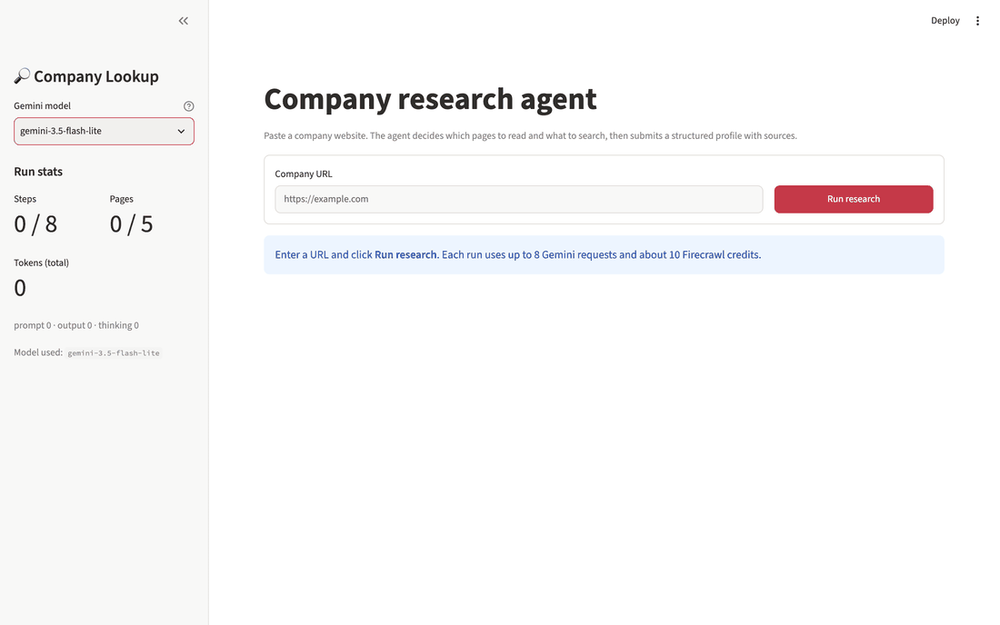
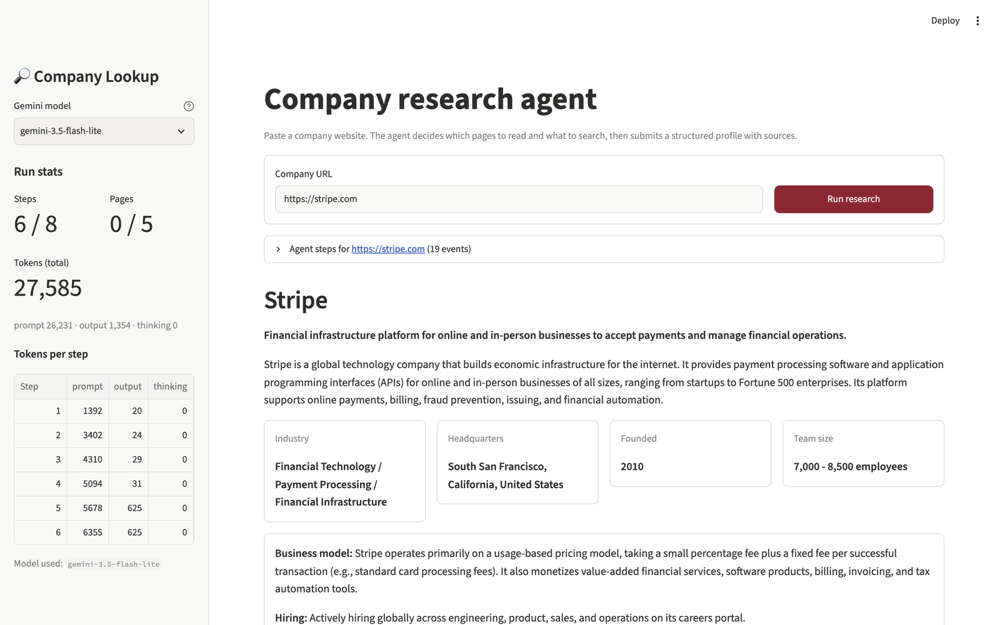
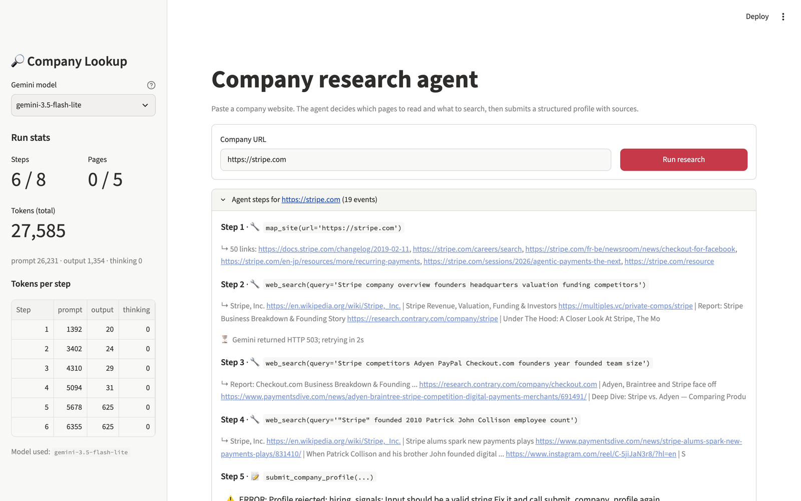
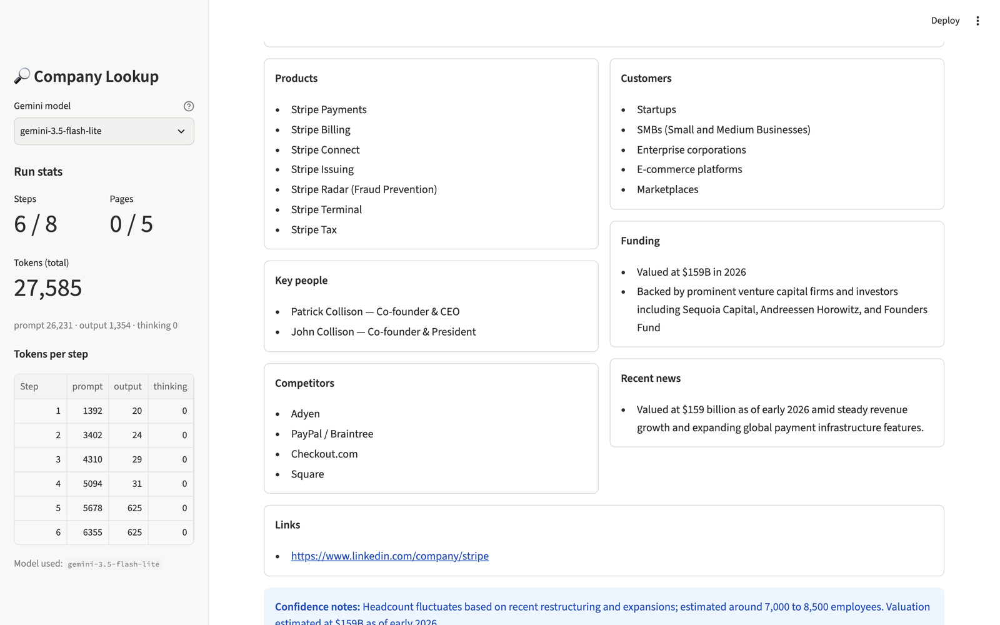
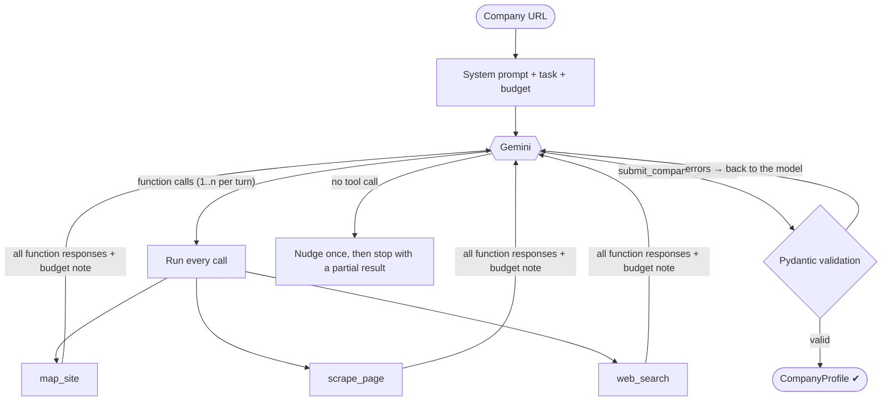

<div align="center">

# 🔎 Company Lookup Agent

**Paste a company URL. An autonomous AI agent decides what to read and what to search, then returns a structured, sourced company profile.**




</div>

---

## Why this project

Most "AI research" demos are pipelines: scrape a page, summarise it. This is an **agent**. The model is given tools and a budget, and it chooses its own next action in a loop until it has enough evidence to submit a profile.

I wrote the agent loop **by hand, without an agent framework**, to understand what frameworks such as LangGraph, ADK or PydanticAI do under the hood: function calling, stop conditions, error recovery, structured output and context budgets.

## Features

- 🧠 **Autonomous research loop.** Gemini chooses between `map_site`, `scrape_page` and `web_search` at each step, and can call several tools in parallel in one turn.
- 🧾 **Structured, validated output.** The agent finishes by calling a `submit_company_profile` tool whose parameters *are* a Pydantic schema. Invalid submissions are rejected with readable errors, and the model fixes them and resubmits.
- 🔗 **Every fact has a source.** The profile includes the URLs of the pages and search results it used, plus confidence notes for anything estimated.
- 📺 **Live step log.** The Streamlit UI streams every tool call, result preview, retry and nudge as it happens.
- 📊 **Token and budget tracking.** Per-step prompt, output and thinking tokens; step and page budgets shown in the sidebar and fed back to the model on every turn.
- 🛡️ **Robust by design.** Retries with backoff on rate limits and overloads, fails fast on a daily quota, returns tool errors to the model so it can recover, and treats scraped content as untrusted data.
- ⬇️ **Export** the profile as JSON or Markdown.

## Screenshots

| Profile with run stats | Agent steps |
|---|---|
|  |  |

<details>
<summary>More of the profile</summary>



</details>

## How it works



The loop in [`agent.py`](src/company_agent/agent.py) is a Python **generator** that yields events (`tool_call`, `tool_result`, `usage`, `retry`, `nudge`, `final`). The CLI and the Streamlit UI simply consume that stream.

| Concern | How it is handled |
|---|---|
| **Stopping** | The terminal tool `submit_company_profile` ends the run. On the last step the model is *forced* to submit (`FunctionCallingConfig(mode="ANY")`). |
| **Structured output** | One Pydantic model is the tool schema, the validator and the UI's result type. There is no separate "now give me JSON" call. |
| **Self-correction** | Validation errors such as `founded_year: must be between 1800 and 2026` go back to the model as the tool response. |
| **Parallel tool calls** | Every call in a turn is executed, and all responses are returned together in one message. |
| **Context budget** | Pages truncated to 5,000 characters, search snippets to 500, at most 5 scrapes and 8 steps; the remaining budget is stated in every turn. |
| **Failures** | Tool exceptions become `{"error": ...}` for the model to handle; HTTP 429/500/503 are retried with backoff. |
| **Streamlit reruns** | The agent runs only inside the button handler. The results live in `st.session_state`, so other clicks never re-run the agent. |

## Tech stack

- **LLM:** Google Gemini (`gemini-3.5-flash`, free tier) through the `google-genai` SDK, with manual function calling.
- **Web data:** [Firecrawl](https://firecrawl.dev) for site mapping, main-content scraping to Markdown, and web search.
- **Schema and validation:** Pydantic v2.
- **UI:** Streamlit.
- **Tooling:** uv, Python 3.12, pytest.

## Getting started

```bash
# 1. Install uv (https://docs.astral.sh/uv/) and the dependencies
brew install uv
uv sync

# 2. Add your API keys (both have free tiers)
cp .env.example .env
#   GEMINI_API_KEY    → https://aistudio.google.com  ("Get API key")
#   FIRECRAWL_API_KEY → https://firecrawl.dev

# 3. Check the setup (prints only which keys are missing)
uv run python -m company_agent.config
```

### Run

```bash
uv run streamlit run app.py                           # web UI → http://localhost:8501
uv run python -m company_agent.agent https://stripe.com   # CLI: prints every step + the profile
uv run python examples/hello_gemini.py                # minimal function-call round trip
```

### Test

The agent loop is tested against a scripted fake Gemini client and fake tools, so the tests use no network and no API quota.

```bash
uv run pytest
```

The tests cover parallel tool calls, budget countdown, nudging, step caps, forced submission, tool-error recovery, rejected-then-corrected submissions, token accounting, and rate-limit handling.

## Project structure

```
src/company_agent/
  agent.py       # the agent loop (generator of events) + CLI
  tools_sdk.py   # Firecrawl tools: map_site, scrape_page, web_search
  schema.py      # CompanyProfile (Pydantic) + submit_company_profile tool
  prompts.py     # system prompt, nudge, budget notes
  config.py      # env loading, model name, limits
app.py           # Streamlit UI
tests/           # offline tests with fake model + fake tools
docs/plan.md     # the build plan and milestones
```

## Free-tier notes

- Gemini's free tier allows about **20 requests per day per model**. One run uses up to 8, so plan on about 3 runs per model per day. Switch to `gemini-3.5-flash-lite` in the sidebar for a separate quota.
- Firecrawl uses 1 credit per map or scrape and about 2 per search, so a run costs roughly 7–12 credits.

## Roadmap

- [ ] Swap the tools to the **Firecrawl MCP server**: same loop, standard tool discovery.
- [ ] A **critic pass** that checks the profile for unsupported claims and triggers extra research.
- [ ] A result cache and a compare-two-companies mode.
